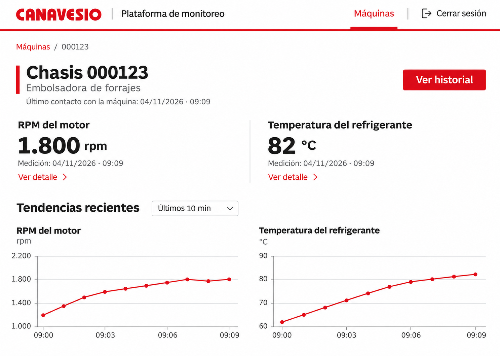

# Interfaces del P1

Fecha: 04/11/2026.

## Estado y alcance

El alcance del P1, la dirección visual y los criterios de interacción de esta ficha fueron aprobados por el responsable el 04/11/2026. La base aprobada se utilizó para construir el prototipo editable en Figma. El responsable revisó la presentación y solicitó ajustes en el detalle de lectura y el selector de período, que fueron incorporados. La referencia se consolida para continuar con P1; permanecen pendientes los cuatro hallazgos de la revisión y la prueba interactiva del reproductor.

Este documento es una referencia de diseño de interfaz ligada al prototipo; no sustituye las fuentes canónicas ni acredita implementación o validación funcional.

## Confirmado

- Cuatro vistas: acceso, máquinas autorizadas, detalle de máquina e histórico.
- Dos variables: RPM del motor y temperatura del refrigerante.
- Dirección visual clara: logo de Canavesio y rojo de marca, navegación superior, fondo blanco, separadores discretos y poco uso de contenedores.
- El detalle presenta últimos valores con sus unidades y fecha de medición, último contacto con la máquina y tendencias recientes debajo.
- Las aclaraciones de simulación no forman parte de la interfaz operativa. La procedencia y las limitaciones de los datos de prueba se documentan en los escenarios.
- Ocurrencia y recepción conservan significados distintos. La recepción y otros metadatos se consultan mediante el detalle de la variable.
- Se muestran las fechas y horas de Argentina, sin etiqueta de zona horaria ni configuración de zona en P1. Se conserva el instante UTC original en el intercambio y almacenamiento.
- La vista podrá crecer con otras variables mediante desplazamiento vertical en incrementos posteriores.
- La detección de sesiones y los estados operativos permanecen fuera de P1.

Referencia visual elegida:

## Criterios de interacción aprobados

### Navegación y acceso

- Recorrido: acceso → máquinas autorizadas → detalle → histórico.
- El acceso presenta identificador de usuario, contraseña, acción de ingreso y mensaje de error genérico.
- Después de ingresar se muestra la lista autorizada, aunque inicialmente contenga una sola máquina.
- El listado identifica cada máquina por su chasis, preservando los ceros iniciales, muestra el último contacto y permite abrir su detalle.
- La selección de máquina se mantiene al navegar entre detalle e histórico.
- Una sesión web vencida solicita un nuevo ingreso. Un acceso denegado no revela datos de la máquina.

### Detalle de máquina y tendencias

- Cada variable presenta nombre, último valor disponible, unidad, fecha de medición y enlace «Ver detalle».
- El último contacto autenticado se presenta como «Último contacto con la máquina», separado de la fecha de las mediciones.
- El selector de tendencias comparte el período entre ambos gráficos. Las opciones iniciales de interfaz son «Últimos 10 min», «Última hora» y «Últimas 24 h», con diez minutos por defecto. Son ventanas de consulta, no parámetros de monitoreo de la máquina.
- En escritorio y tablet, el período se selecciona mediante una lista desplegable anclada debajo del campo. El campo incluye un indicador de despliegue; la lista resalta la selección y se cierra al hacer clic fuera, sin oscurecer el fondo. En móvil se mantiene la presentación compacta anterior.
- La ventana reciente se refiere al momento de consulta. Un período sin registros muestra ausencia de datos; no se desplaza silenciosamente hasta datos antiguos.
- Los gráficos tienen el mismo eje temporal, escalas y unidades independientes y puntos correspondientes a registros disponibles.
- Pasar el puntero por un punto, o seleccionarlo en móvil, permite consultar su valor y fecha.
- Una actualización de datos conserva el período seleccionado, la posición de lectura y el detalle abierto. La cadencia se concretará como configuración de implementación, sin un valor fijado por este diseño.
- «Ver historial» abre la consulta histórica de la misma máquina e incorpora como intervalo inicial la ventana reciente que se estaba consultando.

### Detalle de variable

- Se abre en un panel lateral en escritorio y una vista de ancho completo en móvil.
- El detalle utiliza una cabecera con cierre, identificación de variable y chasis, un bloque de valor y calidad y filas alineadas para medición, recepción y antigüedad.
- Presenta nombre, valor cuando sea válido, unidad, calidad, ocurrencia completa, recepción completa y antigüedad.
- La antigüedad se calcula respecto de la ocurrencia; no se confunde con tiempo desde recepción ni con último contacto.
- Puede cerrarse sin perder el contexto del resumen.
- Los metadatos conservan los valores y el contexto correspondientes al registro consultado.

### Histórico

- Consulta de una variable por vez. RPM es la selección inicial al ingresar desde «Ver historial».
- Filtros de inicio y fin con fecha y hora, selector de variable y acción «Consultar».
- El intervalo inicial se hereda del detalle. Los filtros se mantienen al volver a la máquina y regresar al histórico durante la navegación.
- Las fechas introducidas y mostradas se interpretan en hora de Argentina. Inicio posterior al fin genera un mensaje junto al filtro y no ejecuta la consulta.
- Gráfico y tabla representan la misma variable y período, ordenados por ocurrencia.
- La tabla muestra fecha de medición, valor y unidad; la calidad se señala cuando afecte la interpretación y los metadatos completos permanecen accesibles desde el registro.
- Si la tabla necesita paginación, se muestran el total y los controles; el gráfico representa el intervalo consultado, no solamente la página visible. No hay truncamiento silencioso.
- No se incluyen CSV, observaciones, alertas ni sesiones en P1.

### Estados alternativos

- Carga inicial: indicador en el área afectada.
- Sin máquinas autorizadas: mensaje específico, sin listado vacío ambiguo.
- Sin mediciones o sin resultados en el período: mensaje contextual; ausencia no equivale a cero.
- Dato inválido: no se presenta su número como una lectura utilizable. Se muestra una indicación textual y el detalle disponible; no se reemplaza silenciosamente por un valor válido anterior.
- Dato desactualizado: se mantiene el último valor válido con su fecha y una indicación textual visible. La vigencia utiliza la regla aplicable del catálogo o configuración; este diseño no fija un umbral nuevo.
- Una variable sin información no oculta la otra.
- Los gráficos no conectan huecos ni registros inválidos como si hubiera continuidad. Los registros sujetos a revisión permanecen fuera de la consulta operativa normal.
- Error de consulta: mensaje y acción «Reintentar». Si se conserva una consulta anterior, se identifica como anterior.
- La ausencia de contacto no se presenta como apagado ni como falla mecánica.
- Ningún estado depende solamente de un color.

### Adaptación visual

- Revisar las vistas a 1366, 768 y 360 px.
- Dos columnas para lecturas y gráficos cuando el ancho lo permita; una columna en móvil.
- En móvil, mantener juntas la lectura y la tendencia de cada variable. Se conserva un único selector de período.
- Desplazamiento vertical de la página. El historial conserva legibilidad sin reducir excesivamente el texto; la tabla puede tener desplazamiento horizontal identificado si es necesario.
- Las nuevas variables de incrementos posteriores podrán agruparse por subsistema, sin introducirlas en P1.

## Prototipo en Figma

[Archivo editable](https://www.figma.com/design/u4Pk0hh7Cdh0AoKbfLbXpH) · [Guía de revisión](https://www.figma.com/design/u4Pk0hh7Cdh0AoKbfLbXpH?node-id=13-3779).

Construido el 04/11/2026. La guía ofrece entradas para escritorio, tablet, móvil y estados alternativos. Para recorrerlo, abrir la guía y usar la presentación de prototipo de Figma.

Incluye las cuatro vistas a 1366, 768 y 360 px, panel de detalle de variable, selección de período y variable, tendencias, tabla histórica y once estados alternativos. Las variantes de período y variable conservan el contexto al navegar entre resumen e histórico.

El lienzo utiliza textos, vectores y componentes editables. El logo conserva su vector y rojo originales; las acciones pequeñas usan un rojo ligeramente más oscuro para mejorar el contraste sobre blanco.

La verificación estructural inicial comprobó los destinos, 180 enlaces de registros y 52 condiciones de conservación de la selección, sin incidencias en esos controles. La revisión posterior identificó cuatro hallazgos de coherencia e interacción; esa verificación inicial no los cubría. Se inspeccionaron capturas de las composiciones principales, contenido móvil desplazable, estados de calidad y paneles.

Límites de esta evidencia:

- Los datos son fijos y los campos de usuario, contraseña y fechas no admiten entrada libre en el prototipo.
- No se ejecutan autenticación, consultas reales ni API.
- Los enlaces se comprobaron estructuralmente; no se automatizó una ejecución de clics en el reproductor.
- La revisión visual y los ajustes solicitados no acreditan implementación de software ni validación funcional o física. Los pendientes se conservan en el informe de revisión.

[Evidencia de verificación inicial](verificacion-figma-p1.json).

Ajuste posterior a las capturas del informe de revisión, del 04/11/2026: se reformateó el detalle de lectura y se sustituyó el selector central de escritorio y tablet por listas ancladas. [Verificación del ajuste](verificacion-ajustes-detalle-selector-p1.json). Las observaciones del informe de revisión permanecen pendientes.

## Trazabilidad con las tareas del P1

| Tarea | Referencia de interfaz |
|---|---|
| [P1-03 · Acceder a una máquina autorizada](https://github.com/gabbce/pf-plataforma-monitoreo-web/issues/3) | Acceso, máquinas autorizadas, sesión vencida y acceso denegado. |
| [P1-06 · Consultar evolución y vigencia](https://github.com/gabbce/pf-plataforma-monitoreo-web/issues/6) | Detalle, tendencias recientes, panel de lectura, histórico, filtros y estados de consulta o calidad. |

Los criterios aprobados de esta ficha orientan la implementación. Cuando una interacción del prototipo difiera, se conserva el criterio documentado y se consulta el [informe de revisión](revision-p1/revision.md). Sus cuatro hallazgos siguen pendientes: coherencia de calidad entre resumen e histórico, área táctil del detalle móvil, consulta de puntos intermedios y aplicación de filtros mediante «Consultar».

Las evidencias corresponden a verificaciones realizadas en momentos distintos. Las capturas del informe preceden al ajuste de panel y selector; la [verificación del ajuste](verificacion-ajustes-detalle-selector-p1.json) documenta ese cambio posterior. No se presentan como capturas del estado más reciente.

Los recursos de marca originales se conservan en [brand/](../../brand/). No se incorporan los metadatos `Zone.Identifier` de Windows. La [imagen elegida](estado-actual-p1.png) conserva la dirección visual; el archivo editable y los criterios de esta ficha precisan las interacciones.

## Revisión del prototipo en Figma

- Recorrido principal completo de las cuatro vistas.
- Apertura y cierre del detalle de variable.
- Filtros, gráfico y tabla del histórico.
- Estados alternativos y adaptación a los tres anchos.
- Correspondencia entre valores destacados, puntos del gráfico e instantes.
- Las interacciones del prototipo representan el comportamiento previsto; no validan las API, la adquisición ni el funcionamiento físico.

## Resumen preparado para el contexto operativo

Pendiente de incorporación en Drive:

El 04/11/2026 se aprobó la base de interfaces del P1: acceso, máquinas autorizadas, detalle e histórico de RPM y temperatura del refrigerante. El detalle combina últimos valores y tendencias recientes, con metadatos completos mediante consulta de detalle y hora de Argentina sin etiqueta de zona. Quedan definidos navegación, filtros, estados alternativos y adaptación a 1366, 768 y 360 px. La referencia visual y los criterios se conservan en docs/diseno/interfaces-p1.md y docs/diseno/estado-actual-p1.png. El prototipo editable en Figma está construido y recibió ajustes de presentación a partir de la revisión del responsable. Se consolidó como referencia para implementar P1, con cuatro hallazgos de revisión y la prueba interactiva pendientes; no se acredita implementación ni validación funcional. El seguimiento de sus vistas corresponde a P1-03 y P1-06 en GitHub. La detección de sesiones permanece fuera de P1 y como propuesta a evaluar al definir P2.

## Referencias

- [Registro de incrementos de desarrollo y validación](https://docs.google.com/document/d/1HEcfnedONjGtWyyDrDRskmFqxkQ3vq_fDSl03aKEdiA/edit).
- [Diseño detallado de la plataforma](https://docs.google.com/document/d/19Twh3hXmds-d8IhhxrvqQUpINPeg9pSi3yKotonV4Go/edit).
- [Propuesta pendiente de sesiones para P2](../pendiente-p2-sesiones.md).

La aprobación de los criterios se registra en esta ficha. Las tareas P1-03 y P1-06 de GitHub enlazan esta referencia y el archivo de Figma. La actualización del contexto operativo en Drive permanece preparada y no realizada.
