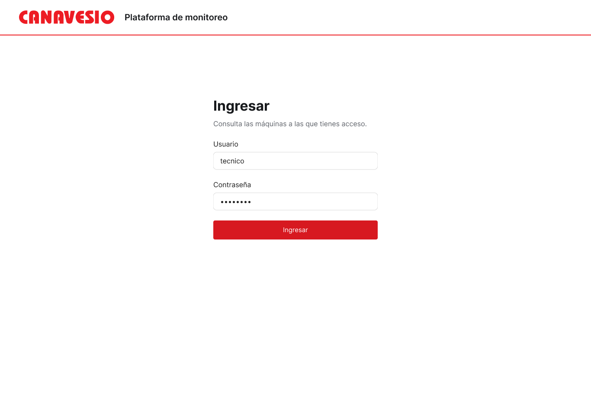
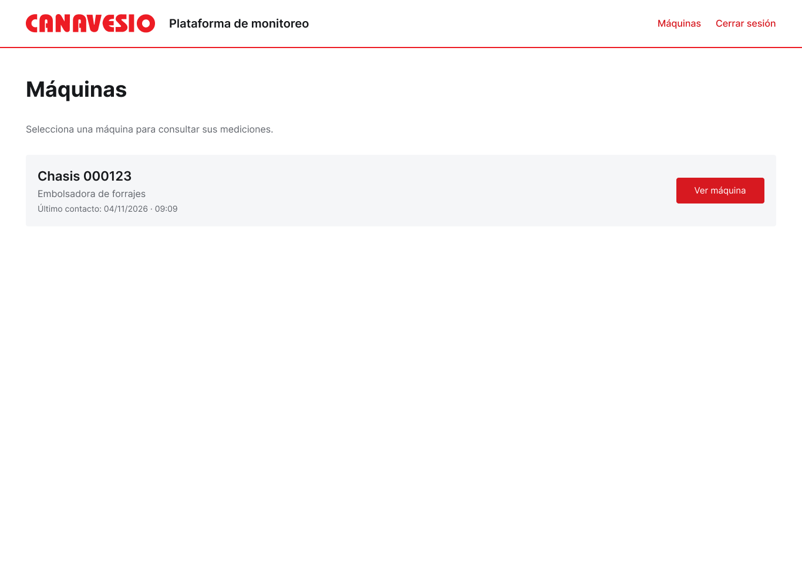
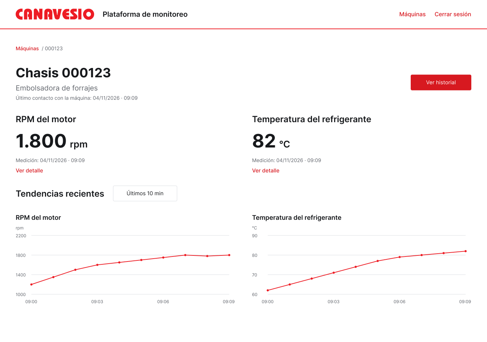
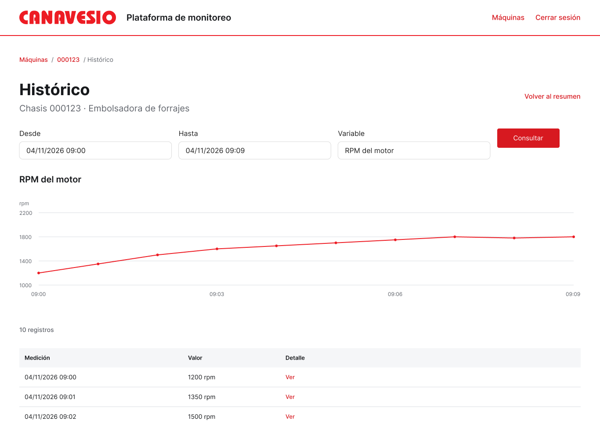
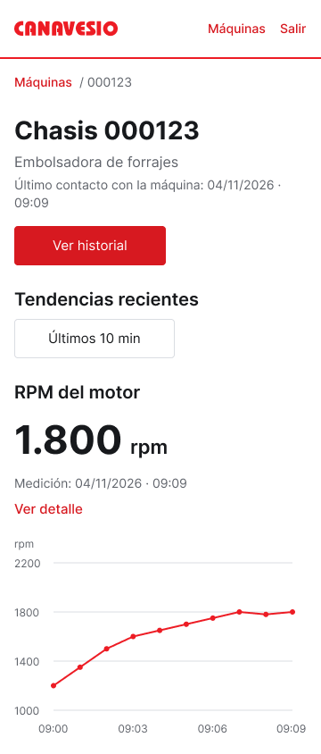
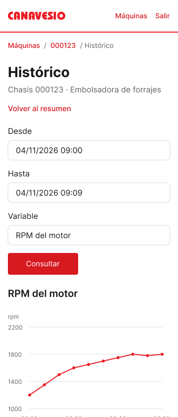
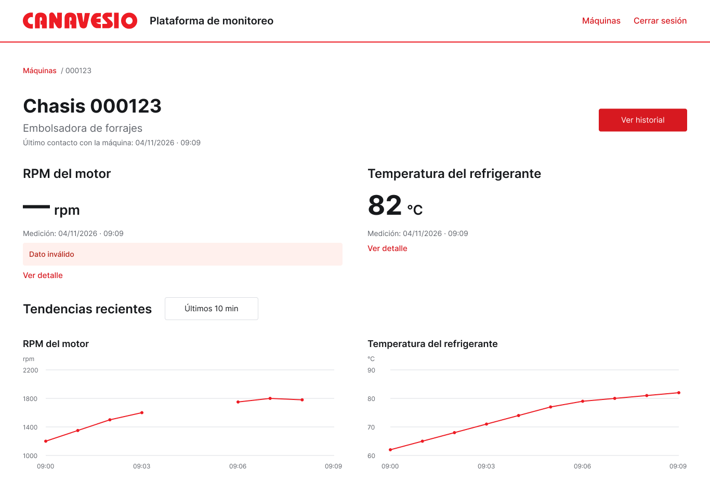
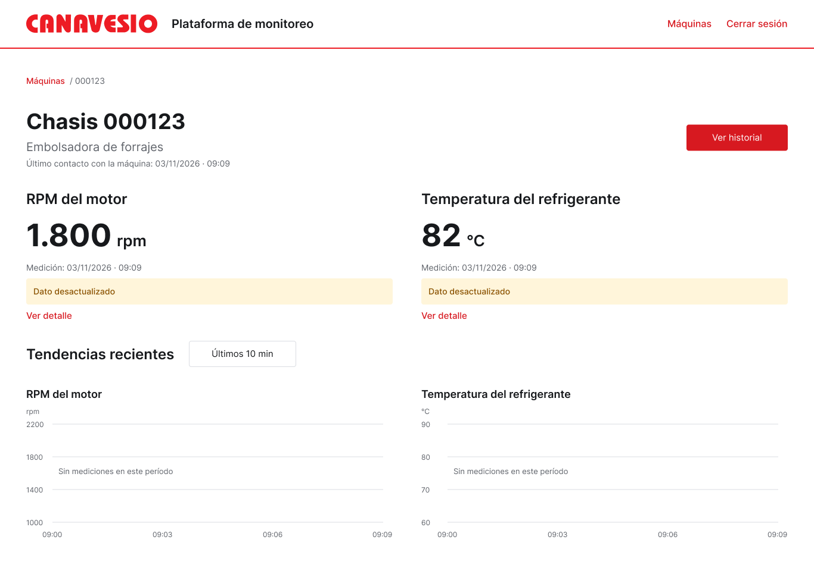
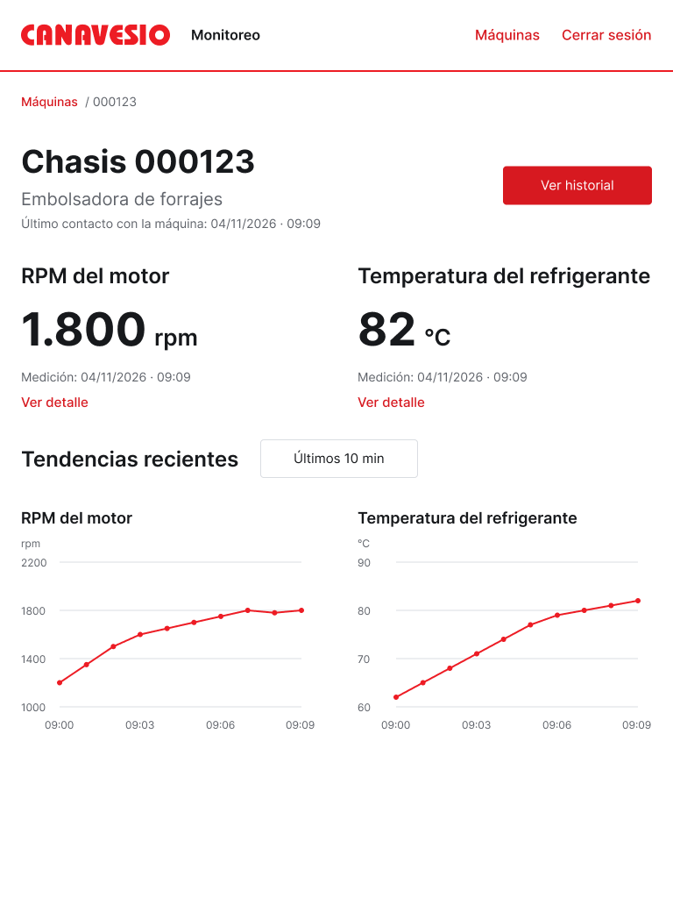
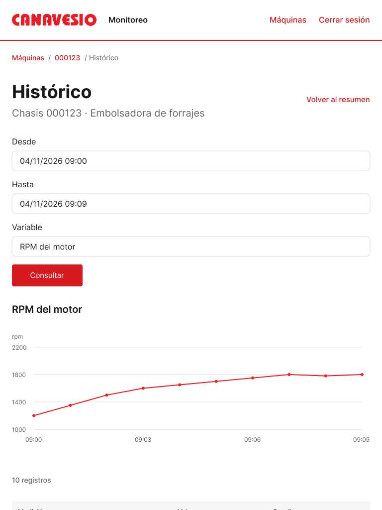

# Revisión de interfaces del P1

Fecha: 04/11/2026.

## Resultado

La organización visual es coherente con la dirección aprobada: marca roja, fondo claro, valores principales visibles y tendencias separadas por variable. Se identificaron dos observaciones de prioridad media y dos de prioridad baja en la coherencia e interacción del prototipo. No se modificó Figma.

Esta es una revisión de capturas actuales y conexiones del archivo. El control del navegador falló al inicializarse, por lo que no constituye una prueba interactiva por clics en el reproductor.

## Vigencia de esta evidencia

Este informe y sus capturas describen la revisión anterior al ajuste de presentación del panel de lectura y del selector de período. Ese ajuste posterior está documentado en la [verificación específica](../verificacion-ajustes-detalle-selector-p1.json). No resuelve los cuatro hallazgos de este informe.

El responsable revisó la presentación y solicitó los ajustes indicados. Permanece pendiente la comprobación interactiva del recorrido. Los criterios vigentes y las tareas relacionadas se conservan en la [referencia de interfaces](../interfaces-p1.md).

## Recorrido revisado

| Paso | Vista | Estado de la revisión |
|---|---|---|
| 1 | Acceso | Presentación clara; campos estáticos conforme a la limitación declarada. |
| 2 | Máquinas autorizadas | Identificación y acción de apertura claras. |
| 3 | Detalle y tendencias | Composición clara en escritorio y tablet; observaciones sobre puntos y continuidad del escenario de calidad. |
| 4 | Histórico | Filtros, gráfico y tabla presentes; observaciones sobre aplicación de filtros y área táctil móvil. |

Las variantes de móvil, tablet y calidad complementan los pasos 3 y 4. El alcance de la revisión del responsable y los ajustes posteriores se aclaran arriba; la validación interactiva permanece pendiente.

## Hallazgos

### Media — El histórico pierde el estado inválido del registro

Ubicación: [detalle con dato inválido](https://www.figma.com/design/u4Pk0hh7Cdh0AoKbfLbXpH?node-id=11-2416) → [histórico de RPM](https://www.figma.com/design/u4Pk0hh7Cdh0AoKbfLbXpH?node-id=8-491), registro del 04/11/2026 a las 09:09.

El resumen muestra RPM inválidas para ese instante. Su conexión de histórico lleva al escenario normal, donde el registro de las 09:09 tiene valor 1.800 y calidad «Válida». El cambio está confirmado en los destinos y asignaciones de variables del prototipo; no se reprodujo por clics.

Impacto: el mismo instante parece cambiar de calidad al navegar y no permite revisar correctamente el tratamiento histórico del dato inválido.

Corrección recomendada: conservar el escenario de calidad al abrir el histórico y el detalle del registro, con valores y huecos coherentes.

### Media — Área táctil pequeña en el detalle del registro móvil

Ubicación: [histórico móvil](https://www.figma.com/design/u4Pk0hh7Cdh0AoKbfLbXpH?node-id=10-1461), columna «Detalle».

El enlace «Ver» mide 22 × 19 px. La fila que lo contiene mide 328 × 44 px y no es seleccionable; sus contenedores tampoco tienen reacción.

Impacto: riesgo de selección imprecisa con el dedo en una acción necesaria para consultar los metadatos.

Corrección recomendada: ampliar el área interactiva con espaciado o permitir seleccionar toda la fila. Es un riesgo inferido de la geometría; no se realizó una prueba táctil física.

### Baja — Solo el último punto de cada gráfico tiene interacción

Ubicación: [detalle de máquina](https://www.figma.com/design/u4Pk0hh7Cdh0AoKbfLbXpH?node-id=8-302), gráficos de RPM y temperatura.

Cada gráfico tiene diez puntos. Solo el último tiene reacciones de selección y paso del puntero; los nueve anteriores no tienen interacción. El punto interactivo mide 6 × 6 px.

Impacto: la consulta de valor y fecha de mediciones intermedias no está representada, aunque está incluida en la ficha aprobada.

Corrección recomendada: conectar todos los puntos a sus muestras y ampliar el área de interacción, especialmente en móvil.

### Baja — El filtro se aplica antes de «Consultar»

Ubicación: [selector de variable](https://www.figma.com/design/u4Pk0hh7Cdh0AoKbfLbXpH?node-id=13-3533) del histórico.

La opción de temperatura navega directamente a su histórico, donde gráfico y tabla ya están actualizados. «Consultar» solo abre el aviso temporal de consulta.

Impacto: la interacción combina actualización inmediata con un botón que parece necesario para aplicar el filtro.

Corrección recomendada: representar los filtros como pendientes y aplicar el resultado al pulsar «Consultar», manteniendo el comportamiento acordado.

## Evidencia visual

Las imágenes se capturaron durante esta revisión, se guardaron y se inspeccionaron antes de aceptarlas.

### Paso 1 — Acceso

Formulario con jerarquía clara y acción principal visible. La autenticación real y la entrada de texto no se evalúan en este prototipo.

### Paso 2 — Máquinas

Chasis con ceros iniciales, último contacto separado y acción de apertura visible.

### Paso 3 — Detalle

Valores y tendencias comparten jerarquía y unidades consistentes. La inspección de conexiones detectó interacción únicamente en el último punto.

### Paso 4 — Histórico

La variable, el período, el gráfico y el total de registros son visibles. La tabla continúa con desplazamiento vertical.

### Variante móvil — Detalle

La ventana visible mantiene juntos el valor de RPM y su tendencia. La segunda variable continúa por desplazamiento vertical.

### Variante móvil — Histórico

Los filtros se apilan. La tabla queda por debajo de la ventana inicial; sus áreas táctiles se evaluaron mediante las capas del archivo.

### Variante de calidad — Dato inválido

El valor no utilizable se sustituye por un guion y una indicación textual; la temperatura sigue disponible. El gráfico conserva huecos. La conexión al histórico normal genera el hallazgo de coherencia.

### Variante de calidad — Datos desactualizados

Los valores anteriores conservan fecha y aviso textual. Las tendencias recientes sin registros se presentan vacías, sin afirmar apagado.

### Variante tablet — Detalle

Las dos variables siguen siendo legibles en dos columnas.

### Variante tablet — Histórico

Los filtros se apilan y el contenido continúa mediante desplazamiento vertical.

## Alcance y límites

- Se inspeccionaron capturas actuales de las cuatro vistas, variantes móviles y de tablet y estados de calidad.
- Las observaciones de navegación se respaldan en conexiones y asignaciones de variables, no en ejecución del reproductor.
- Se descartó una captura aislada del contenido móvil porque seguía recortada por el marco padre; no se presenta como evidencia del contenido completo.
- La entrada de usuario, contraseña y fechas sin texto libre es una limitación previamente declarada del prototipo.
- No se comprobaron navegación por teclado, foco, lector de pantalla, consultas reales ni funcionamiento físico.
- No se modificaron las interfaces, su alcance aprobado ni los documentos de Drive.

[Evidencia estructurada](evidencia.json).
